# Continuidad del planificador: UT9 a UT16

Estado revisado el 5 de noviembre de 2026 en la rama local `ut9-ut10-evaluacion-gemini`. Este documento sirve de relevo para continuar el primer itinerario completo. Resume lo que existe en el código y separa expresamente las siguientes UT. Se basa en `trip_memories_sprints_y_uts.md` (15/10/2026), `contexto_maestro.md` (versión 1.1) y el estado de este repositorio. El README explica el arranque y las UT anteriores.

## Objetivo y frontera actual

El objetivo del Sprint 1 es que una persona configure un viaje de un único destino, entre 1 y 10 días, y reciba un plan diario de lugares reales con desplazamientos a pie, lista y mapa. El **Planner heurístico del backend** debe decidir qué actividades caben, en qué día y en qué orden. Gemini solo aporta afinidad y duración orientativa: **no genera el itinerario final**. Tavily aporta posibles horarios y precios con fuentes: **sus hallazgos no vuelven a Gemini**.

```mermaid
flowchart LR
    A[Configuración validada] --> B[UT8: Geoapify, normalización y filtros]
    B --> C[UT9: Gemini evalúa todos los candidatos]
    C --> D[UT10: validar o usar valoración local]
    D --> E[Tavily: investigar algunos candidatos]
    E --> F[Hoy: lista de candidatos evaluados]
    F -. pendiente .-> G[UT11: tiempos peatonales ORS]
    G --> H[UT12: Planner heurístico por días]
    H --> I[UT13: comidas, descansos y márgenes]
    I --> J[UT14: validar y explicar límites]
    J --> K[UT15: lista diaria]
    K --> L[UT16: mapa sincronizado]
```



La pantalla actual termina en **F**. Confirmar la configuración con `POST /api/itinerarios/confirmar-configuracion` solo la valida y devuelve; no crea ni guarda un itinerario. La persona pulsa después «Buscar lugares disponibles», que llama a `POST /api/candidatos/evaluar`.

## Lo ya implementado

| UT | Estado y contrato útil para continuar |
| --- | --- |
| UT1–UT6 | Destino seleccionado de sugerencias de Geoapify, fechas y horas validadas, intereses, exclusiones, gasto, distancia y resumen confirmable. La disponibilidad es de 1 a 10 días de calendario. El alojamiento es texto opcional; todavía no está geolocalizado. |
| UT7 | Endpoints originales de candidatos turísticos y gastronómicos con Geoapify. Un fallo del proveedor se distingue de una lista vacía. |
| UT8 | `PreparacionCandidatosService` consulta hasta 100 lugares por interés, agrupa por ID Geoapify, elimina duplicados, nombres no válidos y excluidos, conserva categorías, subcategorías, coordenadas válidas y horario si existe. `POST /api/candidatos/preparar` expone los `LugarDto`. |
| UT9 | `EvaluacionCandidatosService` prepara una sola vez y envía **todos** los candidatos conservados a `GeminiClient` en lotes de 40. Gemini devuelve afinidad 1–100 y duración estimada 15–480 min. Se usan referencias temporales `c1`, `c2`, etc.; el ID Geoapify no determina la afinidad. Se ordena por afinidad. |
| UT10 | Se valida la respuesta de Gemini: cantidad, correspondencia de referencias y rangos. Si falta la clave, falla un lote o la respuesta es inválida, se valoran **todos** los candidatos con una regla local determinista y se devuelve `fallback: true` con aviso. La etiqueta y el motivo visibles se generan a partir de categorías e intereses conocidos; el texto libre de Gemini no se presenta como hecho. |
| Investigación complementaria | `TavilyResearchClient` busca progresivamente entre los mejor puntuados, con cierta diversidad de categorías, y extrae precio u horario solo si puede asociarlos a una fuente y al lugar. Sin `TAVILY_API_KEY` se omite la búsqueda y se avisa. No hay segunda llamada a Gemini. |
| Interfaz | `CandidatosLugares` muestra todos los candidatos evaluados, origen Gemini/local, afinidad, motivo seguro, `≈` duración, coste, horario, fuentes, estados de carga/error y avisos. No hay vista por días ni mapa del itinerario. |

La respuesta pública de `POST /api/candidatos/evaluar` es `EvaluacionCandidatosDto`: `candidatos`, `fallback`, `advertencias`, `minutosDisponibles` y `minutosInvestigados`. Cada `CandidatoEvaluadoDto` incluye `lugar`, `afinidad`, `duracionMinutos`, `etiqueta`, `motivo`, `coste`, `precioMinimo`, `precioMaximo`, `moneda`, `confianzaCoste`, `horario`, `horarioFuente`, `estadoHorario`, `informacion`, `fuentes` y `origenEvaluacion`. Conviene reutilizar estos DTO o evolucionarlos explícitamente; no acoplar el Planner a los JSON de Geoapify, Gemini, Tavily u ORS.

`CostLevel` usa `FREE` = 0 €, `LOW` = más de 0 hasta 25 €, `MEDIUM` = más de 25 hasta 50 €, `HIGH` = más de 50 € y `UNKNOWN` cuando falta un precio atribuible en euros. Un precio de búsqueda se marca `ESTIMATED`; un horario externo, `PARTIAL`; un horario que solo llegó de Geoapify permanece `UNVERIFIED`. La duración es siempre estimada. No se rellenan valores desconocidos con cero, «gratis» o «abierto 24 horas».

`CandidatoExceptionHandler` mantiene el patrón HTTP del repositorio: 400 para entrada inválida y 503 para fallo al obtener lugares. Una búsqueda válida sin candidatos devuelve 200 con lista vacía. Si falla Gemini, no se pierde la lista de UT8; si falla Tavily, se conservan los hallazgos anteriores y se avisa. Si falla Geoapify, la alternativa local no inventa candidatos.

### Por qué se hizo así

- **Geoapify antes de la IA:** fija lugares y coordenadas reales; los filtros de intereses y exclusiones reducen lo que debe valorar Gemini.
- **Gemini para afinidad y duración:** ayuda a ordenar candidatos, pero su salida se trata como estimación. En una prueba real produjo motivos con detalles no respaldados; por eso el motivo visible se construye con categorías conocidas.
- **Tavily después de puntuar:** investigar cada lugar desde el inicio consumiría consultas y tiempo. Su plan gratuito sin tarjeta y la búsqueda básica permiten consultar solo los candidatos más prometedores. El backend usa REST directamente; no se instaló CLI ni se cambió la configuración global.
- **Planner propio a continuación:** la decisión temporal y espacial requiere reglas verificables, horarios y recorridos, y debe seguir funcionando si Gemini falla. Esta separación coincide con el contexto maestro del proyecto.

## Configuración, pruebas y evidencia

Las claves se leen de `GEOAPIFY_API_KEY`, `GEMINI_API_KEY` y `TAVILY_API_KEY` en el **proceso del backend**. Tavily es opcional para evaluar candidatos. Las claves usadas en la verificación se pasaron temporalmente al proceso; **no quedaron guardadas en el repositorio ni en el equipo**. No deben añadirse a README, frontend ni archivos versionados. En pruebas sin PostgreSQL, desde `backend`:

```powershell
.\mvnw.cmd clean '-Dspring.flyway.enabled=false' test
```

La última ejecución pasó **237 tests de backend**; `npm run build` pasó en `frontend`. Las pruebas cubren respuestas simuladas de Gemini/Tavily, fallback, límites de coste, capacidad de 600 candidatos de UT8, endpoint y extracción conservadora de fuentes. No equivalen a una medición universal de cobertura de proveedores.

Prueba real del 5/11/2026: Valencia, interés en arte y museos, gasto económico, un día de 10:00 a 18:00. UT8 entregó 81 candidatos y Gemini evaluó todos sin fallback. Con el código actual, Tavily encontró fuentes para 6, precio para 4 (2 gratuitos y 2 de bajo coste) y horario externo para 4. El contador orientativo llegó a 420 de 480 minutos; la petición alcanzó los **100 segundos** y devolvió un aviso de investigación incompleta. Otra ejecución parecida terminó en unos 16 segundos: la latencia y los resultados varían. Una prueba de una hora terminó en unos 13 segundos con precio gratuito y horario de la oficina turística para el Museo de Bellas Artes. Los horarios y precios procedentes de fragmentos siguen siendo parciales/estimados y pueden cambiar en la fuente.

## Límites actuales que afectan a las siguientes UT

1. **`minutosInvestigados` no es capacidad planificable.** Suma duraciones de candidatos con algún hallazgo con fuente; no comprueba fecha concreta, horario, desplazamientos, comida ni ausencia de solapes. Para gasto `ECONOMICO`, solo cuenta los hallazgos clasificados `FREE` o `LOW`. Nunca debe usarse como garantía de un itinerario completo.
2. **Investigación secuencial y variable.** Hay un plazo total de 100 s y hasta 100 búsquedas Tavily por petición; una búsqueda lenta puede dejar la investigación parcial. Con 1.000 créditos gratuitos mensuales, 100 consultas en una sola generación también consumirían una parte considerable de la cuota. Antes de depender de esta fase para 10 días, medir más destinos y decidir presupuesto, caché y concurrencia.
3. **Horarios todavía sin interpretación de calendario.** Geoapify aporta texto bruto; Tavily extrae fragmentos. Ninguno confirma por sí solo que el lugar esté abierto en el día/hora exactos del viaje. UT12/UT14 deben conservar y mostrar la incertidumbre.
4. **Gasto y distancia todavía no intervienen en el ranking de Gemini.** El gasto económico influye en la cobertura de investigación, pero no hay penalización por gasto incompatible ni valoración de desplazamientos. Es trabajo del Planner al disponer de costes y rutas. `UNKNOWN` no se debe tratar como gratis ni como caro confirmado.
5. **Faltan ORS, planificación, comida, validación final, lista por días y mapa del recorrido.** No existe una segunda llamada a Gemini para «hacer el plan». El endpoint de evaluación devuelve candidatos, no actividades programadas.
6. **Sin caché ni cuota de generación.** UT17 prevé controlar solicitudes repetidas. El frontend evita un doble clic durante una petición, pero cada nueva búsqueda puede volver a consumir Geoapify, Gemini y Tavily.

## Trabajo pendiente para completar el primer itinerario

La siguiente tabla reproduce el objetivo y las pruebas de aceptación del documento de UT, y añade la frontera técnica que deja el código actual. Los nombres de clases o endpoints futuros son propuestas, no contratos existentes.

| UT | Entrega pendiente | Integración y prueba de aceptación |
| --- | --- | --- |
| **UT11 — desplazamientos a pie** | Integrar OpenRouteService para tiempos y distancias peatonales entre candidatos útiles. | Crear un cliente/proveedor de rutas y DTO propios. Conservar fuente y estado de cada tramo. Si faltan coordenadas o ORS no devuelve ruta, registrar «recorrido no disponible»; no convertirlo en cero minutos ni inventar geometría. PA 11.1: usar datos peatonales en tramos. PA 11.2: mostrar aviso cuando falte una ruta. |
| **UT12 — plan diario básico** | Construir en Spring Boot una heurística determinista que elija y ordene visitas usando disponibilidad, afinidad, duración, desplazamientos y preferencias blandas. | La entrada debe ser la configuración validada y candidatos evaluados, enriquecidos con rutas. Crear modelo de día/bloque con inicio, fin, lugar/tramo, procedencia e incertidumbre. Evitar solapes, duplicados y actividades fuera de llegada/salida; respetar la ventana de referencia 10:00–18:00 de cada día, recortada por los extremos. Si faltan lugares viables, dejar tiempo libre explícito. PA 12.1: visitas y traslados caben. PA 12.2: plan parcial sin inventar. |
| **UT13 — comidas, descansos y márgenes** | Insertar bloques de comida y descanso y márgenes realistas entre visitas. | Recalcular encaje temporal; mostrar opciones de comida como recomendaciones, sin presentarlas como reservas. PA 13.1: todos los bloques caben sin solapamientos. |
| **UT14 — validar y explicar limitaciones** | Verificar el plan completo antes de responder. | Comprobar horarios conocidos, rutas, límites, duplicados, tiempos, exclusiones y niveles de certeza. Si un dato es incierto o un conflicto impide encajar algo, explicar el motivo y devolver un plan parcial o un aviso, nunca una certeza falsa. PA 14.1: conflicto e incertidumbre visibles. |
| **UT15 — itinerario por días** | Presentar días, visitas, traslados y detalles en una lista navegable. | Sustituir la lista de candidatos como resultado principal de «generar» una vez exista el endpoint del Planner; mantener una vista de candidatos si sirve para diagnóstico/edición. Al cambiar de día no deben quedar detalles del anterior. PA 15.1: contenido y detalles correctos por día. |
| **UT16 — mapa de lugares** | Mostrar marcadores del plan sincronizados con la lista. | Usar coordenadas reales del candidato; un lugar sin par de coordenadas válido puede seguir en lista, pero no debe recibir marcador ficticio. El clic en lista y mapa destaca el mismo lugar. PA 16.1: sincronización en ambos sentidos. La geometría detallada del recorrido corresponde a UT28. |

Después de UT16, **UT17** controla el consumo inicial y reutiliza datos vigentes para evitar generaciones repetidas. Más adelante, UT18 localiza el alojamiento y UT19/UT20 introducen lugares obligatorios, preferidos y evitados; el Planner debe permitir esa evolución sin asumir que esos datos existen hoy. La edición, persistencia y variantes pertenecen a UT posteriores y no deben presentarse como parte ya terminada del primer plan.

## Orden de implementación sugerido

1. Definir el contrato interno `tramo a pie` con tiempo, distancia, fuente y estado. Implementar UT11 y sus fallos simulados; mantener las claves solo en backend.
2. Definir DTO de `ItinerarioDia`/`Bloque` y un servicio Planner que consuma `EvaluacionCandidatosService` directamente, sin llamada HTTP interna ni nueva consulta de Geoapify por cada etapa. Añadir UT12 con un día, diez días y casos parciales.
3. Incorporar bloques y márgenes de UT13; verificar que los tiempos se recalculan cuando cambia el orden.
4. Centralizar la validación y advertencias de UT14, diferenciando dato confirmado, estimado, parcial y desconocido. Decidir explícitamente qué hacer con un horario o tramo no verificable.
5. Construir UT15 y UT16 sobre el mismo identificador y DTO del plan; comprobar navegación por días, ausencia de estado antiguo y sincronización lista/mapa.
6. Atender UT17 con límites y reutilización para proteger la cuota gratuita de APIs, y volver a medir Tavily en varios destinos y duraciones antes de usar su cobertura como criterio de garantía.

Seguir el patrón actual del repositorio: `controller` delega en `service`, integraciones en `client`, respuestas en `dto`, errores traducidos por `exception` y pruebas por capa. Conservar `LugarDto.id` solo como identificador de correspondencia, nunca como señal de afinidad. Cualquier dato externo nuevo debe tener procedencia o permanecer desconocido.

## Decisiones que el equipo debe cerrar antes de UT12/UT14

- Política ante una ruta peatonal ausente: dejar la pareja fuera de la planificación garantizada o incluirla marcada como provisional, sin asignarle un tiempo ficticio.
- Política ante horarios ausentes o no interpretables: qué actividades pueden mostrarse como propuestas condicionadas y cómo se impide que la interfaz afirme que están abiertas.
- Peso concreto de afinidad, distancia, gasto, variedad y horario en la heurística. El contexto maestro ofrece una fórmula conceptual, no pesos aprobados ni implementados. Un coste `UNKNOWN` necesita tratamiento propio.
- Presupuesto de búsquedas Tavily por generación y por mes, caché, latencia aceptable y fuente mínima para afirmar precio u horario. La medición actual no justifica una garantía de cobertura para viajes de 10 días.
- Contrato del endpoint final de generación y modelo de advertencias, antes de construir la lista y el mapa. Mantener la API existente de candidatos para compatibilidad hasta decidir su papel final.
